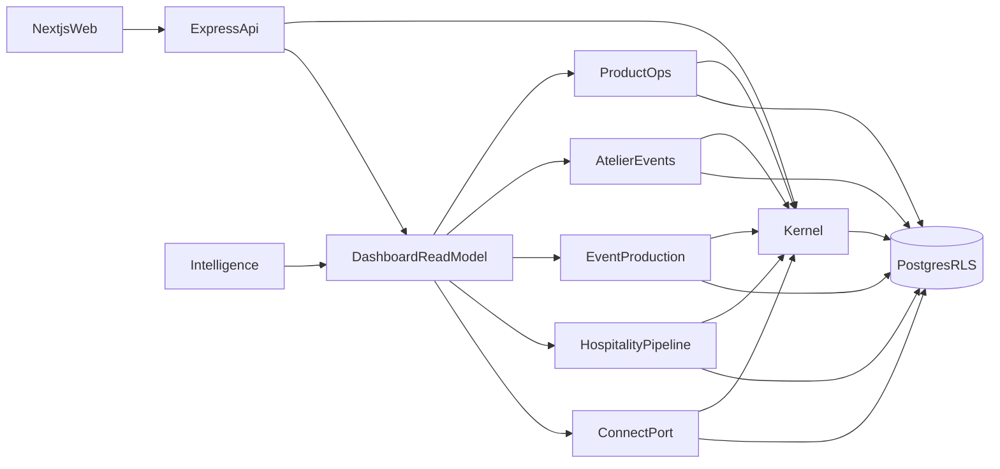

# Stemworks architecture

Confidential. Diaz Ventures LLC · Stemworks LLC · 2026.

Stemworks is the operating system for Diaz Ventures LLC. It runs the parent company's ventures, and it is the product those ventures will later license. This document is the architecture those builds have to follow. It reconciles three sources:

1. Technical Specification v1.0 (April 2026) — schema, API, roles, stack, and security controls. Wins on those subjects.
2. Dashboard Specification (2026) — the founder read model, venture language, and branch status. Wins on the shape of the dashboard.
3. Native Module Client Definitions (2026) — the two licensable modules, Event Production and Hospitality Pipeline. Wins on what those modules are.

Phase numbers in the sources do not match. This architecture does not pick a calendar. It isolates modules so either schedule can ship without rewriting the kernel.

Companion documents:

- [modules.md](modules.md) — aggregates, ports, and which venture enables which module
- [security.md](security.md) — authentication, row-level security, ledger, secrets, logging, CI
- [dashboard.md](dashboard.md) — the four zones, filter rules, and Phase 1 data sources
- [spec-gaps.md](spec-gaps.md) — places a field list omitted a column the prose requires, and the decision recorded for each

## System

One tenant in production at the start: Diaz Ventures LLC, `plan_tier = internal`. Four ventures, stored as `subsidiaries`. A venture and a subsidiary are the same row. The dashboard's word and the schema's word are not two concepts.

| Venture | `type` | Prefix | Day-one posture |
| --- | --- | --- | --- |
| Jade Flowers | `product_brand` | `JF` | Active. Product operations and Candle Atelier. |
| Jade Experiences | `event_production` | `JE` | Active as a series (Voices & Visions). Module contract only until Event Production is built. |
| Jade Haven | `wellness_hospitality` | `JH` | Pre-revenue, development. Hospitality contract only. |
| Stemworks | `software` | `SW` | Pre-revenue, validation. The product's own pipeline, not the platform kernel. |

`DV` stays the parent prefix. It is not a venture prefix. The Stemworks venture is not a place to store another tenant's data, and it is not the code that runs the API.

The technical spec's subsidiary enum is `product_brand | wellness_hospitality | software`. `event_production` is the required extension so Jade Experiences can exist as its own venture. Recorded in [spec-gaps.md](spec-gaps.md).

## Boundaries that stay intact

These are the mistakes that would force a rewrite later. Each one is a separate module with its own tables.

**Candle Atelier and Event Production are different products that both use the word event.** Atelier is a session hosted by a product brand: capacity, deposit, attendance, no-show, cost buckets (hospitality, materials, overhead), net profit, and whether an attendee bought product afterward. Event Production is a recurring cultural series: a talent roster and contract terms that carry from one volume to the next, a run-of-show template that accumulates notes, ticket tiers (early bird, general admission, door) against capacity, an edition P&L closed within a day, and a content archive. Jade Flowers enables Atelier. Jade Experiences enables Event Production. Neither module reads the other's tables.

**Hospitality Pipeline is the operating record of a first wellness property.** Lease, capital partners, corporate wellness accounts, rent-to-revenue density, and a mode of `pre_open` or `operational`. Opening archives the capital and development pipeline. Hospitality does not store batches, orders, or talent.

**Confirmed and Potential are projections of money already in the system.** Confirmed is revenue committed, converted, or contracted. Potential is the full value of active deals in motion. The gap is the execution target. Phase 1 shows those two numbers and nothing predicted. The `intelligence` module may later add Predicted from that founder's own history, each figure labeled with confidence. Industry averages are not a source.

**Integrations are a port, not a dependency of the core.** The technical spec lists third-party integrations as out of scope for the first build. The dashboard's Connect track (Craftybase, Square, Shopify, and later Eventbrite, HoneyBook, HubSpot, Salesforce) talks only to the Connect port. Domain services do not import adapter code.

## Shape

A modular monolith. One Next.js 14 web app, one Express API, one PostgreSQL database, Prisma for schema and migrations. Modules are packages with a one-way dependency rule: a module may depend on kernel ports, and on nothing else. A module never imports another module, and never touches another module's Prisma delegates or tables. The dashboard is a read model that calls ports. It is not a fifth place where business rules live.

Layout when implementation starts:

- `apps/web` — Next.js 14, TypeScript, Tailwind. No database client. Talks only to `/api/v1`.
- `apps/api` — Express. Routes are thin: authenticate, open one transaction, set tenant context, authorize, validate, call one module service.
- `packages/kernel` — identity, tenancy, authorization, money, audit, ventures, milestones, attention.
- `packages/modules/product`, `atelier`, `event-production`, `hospitality`, `intelligence`, `connect` — each has `domain/`, a `ports.ts` of what the dashboard may call, and an `internal/` that is not exported.
- `packages/db` — Prisma schema, plus raw SQL migrations for row-level security. Prisma cannot express those policies. They are reviewed beside the schema.

Hosting, when a build is deployed: web on Vercel, API and PostgreSQL on Railway or Render (Supabase is an acceptable managed Postgres). Email via Resend when a message is actually sent. Stripe arrives with licensing, not before. The GitHub repository is private and owned by a Diaz Ventures LLC account.

## Kernel

Every tenant-owned table carries `tenant_id`, including child tables whose field lists in the spec omitted it. The rule in the spec is that all tables include it. Primary keys are UUIDs. Timestamps are `timestamptz` in UTC. Money is an integer number of cents on every money path. Physical quantities stay `decimal`, as specified for on-hand amounts, fragrance load, and yield.

**Identity.** `tenants`, `users`, `user_roles`. Email is unique per tenant. `password_hash` is bcrypt with cost factor 12 and is never selected back to a client. A user has exactly one role per subsidiary, and may hold different roles in different subsidiaries. The owner role is the only tenant-wide role (`subsidiary_id` null) and there is one owner row per tenant. Roles: `owner`, `manager`, `associate`, `client`, `platform_admin`. The first build seeds a single owner. The checks for the other roles exist and are tested before those users exist. Hiding a button is not a control.

**Sessions.** The access token expires in 15 minutes and carries `sub`, `tenant_id`, and a role snapshot. The refresh token expires in 7 days, is stored only as a hash, rotates on every use, and is revoked on logout. Logout cannot invalidate a refresh token that the server has never stored. Public routes are `POST /auth/login` and `POST /auth/refresh` only. Login returns the access token in JSON. The refresh token is an `HttpOnly`, `Secure`, `SameSite=Strict` cookie scoped to the auth routes. Detail is in [security.md](security.md).

**Authorization.** Enforced on the handler, then again by row-level security.

- Owner: every module in the tenant, parent P&L, settings and user management.
- Manager: one subsidiary, operational and financial data, no parent P&L, no other subsidiary, no settings.
- Associate: may create a batch and may not edit it; inventory is view only; no COGS, margin, or P&L; orders only when `attributed_to` is that user, and only the operational fields; events are view plus check-in.
- Client: own Haven profile only. That module is not in the first build. A client token receives 403 on every current route.
- Platform admin: a separate route surface for tenant health counts. Those handlers do not query operational tables. There is no branch of the form "if admin, skip the filter."

**Tenancy.** The API connects as `stemworks_app`, which is not a superuser, is not the table owner, and has `NOBYPASSRLS`. Migrations connect as a different role. Each request is one transaction and begins with `SELECT set_config('app.tenant_id', $tenant, true)`, so the setting ends at commit. A session-level `SET` is forbidden: pooled connections would keep the previous tenant. Application `WHERE` clauses are a second filter.

**Money and inventory.** Cost on a batch line and cost on an order line are snapshots taken at write time. History is not recomputed from today's purchase price. On-hand quantity is a balance maintained in the same transaction as an append-only movement ledger. The balance is not edited by hand. Batch create, deduction, and the ledger insert commit together or roll back together. The same rule covers finished goods released from QC, and units available to sell (`units_on_hand - units_allocated`).

**Audit and the primitives modules may use.** `audit_events` is append-only and records login, logout, role changes, and any mutation of money, inventory, batch status, or credentials. Logs carry a request id, tenant id, user id, route, and status. They do not carry email, phone, or name. Modules may call kernel ports for ventures and module enablement, milestones, and attention items. Dismissing an alert archives it. A module does not write the dashboard's tables. There is no global deals table. Each module implements a pipeline port that returns `{ label, stage, valueCents, kind }`.

## Modules

Full aggregates and the enablement table are in [modules.md](modules.md).

| Module | First build | Enabled on | Holds |
| --- | --- | --- | --- |
| `product` | Yes | Jade Flowers | Materials, purchases, batches, SKUs, lineage, customers, orders, COGS, subsidiary P&L |
| `atelier` | Yes | Jade Flowers | Candle Atelier sessions, registrations, deposits, attendance, session P&L |
| `event-production` | Contract only | Jade Experiences | Series, editions, talent carry-forward, run-of-show, ticket tiers, edition P&L, content archive |
| `hospitality` | Contract only | Jade Haven | Property and lease, capital partners, corporate accounts, rent-to-revenue, pre-open mode |
| `intelligence` | Dormant | None until a founder has enough of their own history | Predicted, deal health, event velocity, reorder timing, each with confidence |
| `connect` | Port and status rows | Per venture, as adapters are added | Branch connector, secret store, sync inbox. No adapter in the first build |

A route whose module is not enabled for the caller's venture returns 404.

## Connect

`branches` are per venture. Kind is `native` or `integration`. A native branch is always `active` and live: Product, Atelier, Event Production, Hospitality, and the pipeline read surface (the dashboard's "Pipeline CRM" row). An integration branch starts `not_connected`. Credentials live in `branch_secrets`, encrypted with AES-GCM under a key from the environment, never returned by the status API, and never logged. Sync writes normalized facts to an inbox. A projector inside the owning module turns facts into ledger movements or pipeline values. Adapters do not write domain tables. A failed sync files a `branch_sync_error` attention item. Stemworks does not repeat Craftybase, Square, or Shopify notification streams. Alerts are for founder action and for patterns that cross ventures.

Named adapters, none of them in the first core build: Craftybase, Square, Shopify, Eventbrite (ticket counts into Event Production, not a second box office), HoneyBook, HubSpot, Salesforce.

## Dashboard

One screen, four zones, specified in [dashboard.md](dashboard.md). Mobile stacks them in this order: command header, attention rail, venture cards, milestone timeline. Desktop shows all four at once. Filtering to a venture is the same screen with a `subsidiary_id` that must sit in the caller's allowed set. A manager who passes another venture's id receives 404.

The header shows Confirmed and Potential in cents, rendered as money, plus the next milestone and a single top alert. Cards sort by activity. A pin overrides sort. Cards collapse when a venture is quiet and are never removed. The timeline is forward-looking, 90 days by default, expandable to 12 months. Closed work stays in the venture detail.

In the first build, Jade Flowers pipeline figures come from orders, atelier deposits, and open commitments, plus milestones and alerts entered by hand. The other three ventures show their status label, last activity, and any hand-entered milestones or alerts. They do not show invented pipeline numbers.

## API

Base path `/api/v1`. JSON. Money in cents. Timestamps in ISO 8601 UTC. Cursor pagination. Every body and query is validated. An idempotency key is required on batch create, purchase receipt, and event registration, so a retry cannot deduct inventory twice. Auth routes and money routes are rate limited. Error bodies do not contain SQL or token contents.

First-build routes are the spec's auth, batches, materials, inventory alerts, SKUs, financials, and atelier events, plus the dashboard and branch-status reads. Consolidated P&L (`GET /financials/pl/consolidated`) is owner-only and sums subsidiaries inside the one tenant. It never sums across tenants.

## Security bar

The kernel ships with all of the following. [security.md](security.md) is the implementation spec.

- HTTPS only, with HTTP redirected.
- bcrypt cost 12. Refresh tokens hashed, rotated, and revocable. Access token lifetime 15 minutes. A deactivated user fails on the next request even if the access token has not expired.
- Server-side authorization on every handler. Row-level security using a transaction-local tenant setting. The app role cannot bypass row-level security. `FORCE ROW LEVEL SECURITY` is on for every tenant table.
- Integer cents, cost snapshots, inventory ledger and balance in one transaction.
- No personal data in logs. Daily backups kept at least 30 days. Users and tenants are soft-deactivated. Financial rows are not hard-deleted.
- Integration secrets encrypted from the first day a secret exists. Client health data is not collected. Encryption at rest for email and phone waits for the phase that introduces Haven client data, and it applies to that classified store.
- A proprietary header on source files. No open-source license on the product.
- Continuous integration fails a migration that creates a tenant table without `tenant_id`, a row-level security policy, and `FORCE ROW LEVEL SECURITY`.

## Phase gates

**Build first.** Kernel, row-level security, owner authentication, `product`, `atelier`, and the dashboard read model fed by those two modules and by hand-entered milestones and alerts. Branch status rows exist for native modules. Integration rows may exist as `not_connected`.

**Specified here, not built yet.** `event-production`, `hospitality`, Connect adapters, invites for anyone but the owner, the commission engine, wholesale depth beyond the order channel, `intelligence`, Haven operations and the client portal, membership billing, Stripe billing, tenant self-serve provisioning, the platform admin UI, a native mobile app.

**Decisions recorded from the spec, not invented here.**

- Compensation and any equity conversation are a written agreement before code, and that agreement assigns intellectual property to Diaz Ventures LLC.
- Domain versus subdomain is a deployment choice and does not change the architecture.
- Where Candle Atelier deposits are collected (inside Stemworks, Eventbrite, or Stripe) changes which system is the source of a deposit amount. The atelier registration row still records the amount and the time it was paid.
- Licensing price tiers do not change the tenant model. `plan_tier` is already `internal | starter | professional | enterprise`.
- Whether Haven holds health records is an attorney decision. No health table is created before that decision. If the answer is yes, those records go in a separate classified store, not in the hospitality tables.

## Non-goals of this repository pass

This tree is the architecture. It does not contain the Next.js app, the Express API, or the Prisma schema. Implementation follows these documents in the phase order above.
